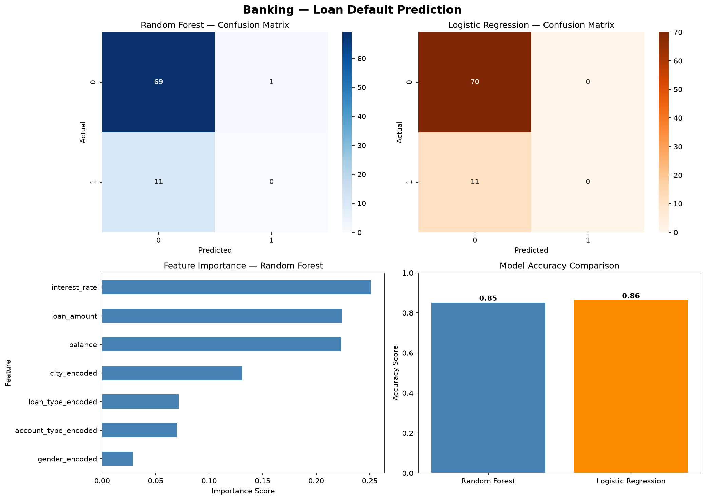
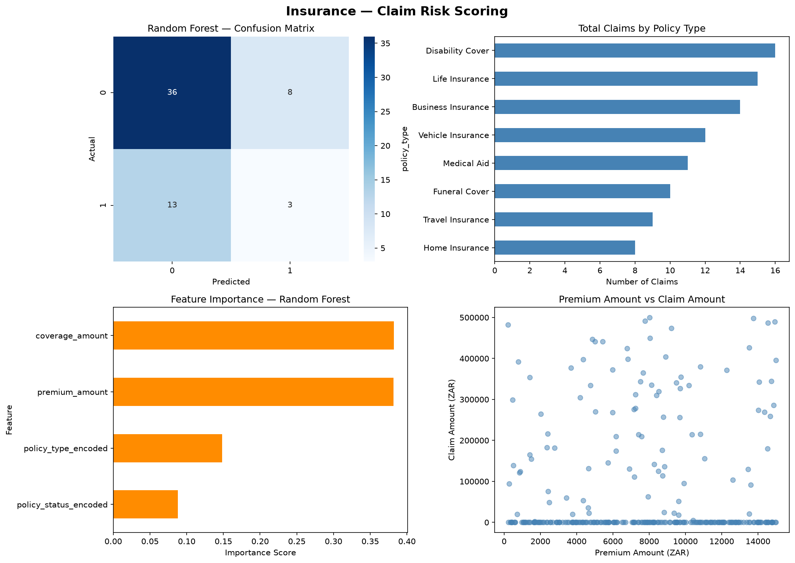
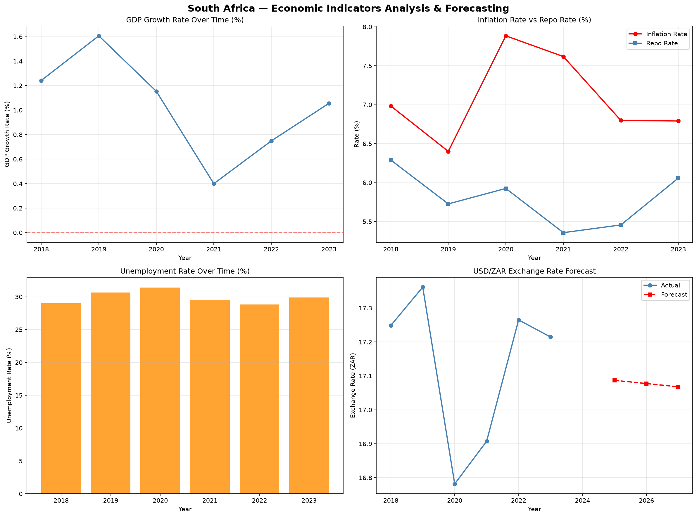

# Financial Intelligence Platform 🇿🇦

A comprehensive South African multi-domain data platform built across 4 professional layers:
**Data Engineering → Analytics Engineering → Data Analytics → Data Science**

---

## Live Dashboard

**[Financial Intelligence Dashboard — Looker Studio](https://datastudio.google.com/reporting/ea65b2bf-9083-4846-8b02-72edc56164d6)**

- 🏦 Banking Analytics
- 🛡️ Insurance Analytics
- 🌍 Economics Analytics

---

## Project Overview

This platform simulates a real-world South African financial intelligence system covering 3 domains:

- 🏦 **Banking** — customers, accounts, transactions, loans
- 🛡️ **Insurance** — policies, claims, risk analysis
- 🌍 **Economics** — South African economic indicators (2019–2024)

---

## Tech Stack & Project Structure

| Layer | Tools | Files |
|---|---|---|
| Data Engineering | Python, PostgreSQL, psycopg2, pandas, Faker | `generate_banking_data.py` `generate_insurance_data.py` `generate_economics_data.py` |
| Analytics Engineering | SQL, PostgreSQL Views, DBeaver | SQL views across all schemas |
| Data Analytics | Looker Studio, Power BI Desktop, DAX | Live dashboard link above |
| Data Science | scikit-learn, matplotlib, seaborn, numpy | `data_science_banking.py` `data_science_insurance.py` `data_science_economics.py` |

---

## Data Summary

| Domain | Table | Records |
|---|---|---|
| Banking | Customers | 500 |
| Banking | Accounts | 1013 |
| Banking | Transactions | 3586 |
| Banking | Loans | 203 |
| Insurance | Policies | 300 |
| Insurance | Claims | 85 |
| Economics | Indicators | 740 |

---

## Machine Learning Models

| Domain | Model | Performance |
|---|---|---|
| Banking | Loan Default Prediction (Random Forest) | 85% Accuracy |
| Insurance | Claim Risk Scoring (Random Forest) | Completed |
| Economics | Economic Forecasting (Linear Regression) | USD/ZAR: R17.09 (2025) |

---

## Data Science Visualisations

### Banking — Loan Default Prediction

### Insurance — Claim Risk Scoring

### Economics — Indicator Forecasting

---

## Google Colab Notebooks

| Notebook | Description | Link |
|---|---|---|
| Banking Loan Default Prediction | Random Forest & Logistic Regression predicting loan defaults | [Open in Colab](https://colab.research.google.com/drive/1y6jyRisLXv-zdTxUsFLo6iX1OFYZT8if?usp=sharing) |
| Insurance Claim Risk Scoring | Claim prediction model by policy type | [Open in Colab](https://colab.research.google.com/drive/1go4Yta9gvaZ-TcLwL-kVEgvAudsxjxey?usp=sharing) |
| Economics Forecasting | SA economic indicator forecasting 2025-2027 | [Open in Colab](https://colab.research.google.com/drive/12NimVbDACZFxkdqm-4Dkz_2XadDqYmYg?usp=sharing) |

---

## Author

**Abulele Maqungo**
- GitHub: [AbuMaqungo](https://github.com/AbuMaqungo)
- LinkedIn: [linkedin.com/in/abulele-maqungo-53938b241](https://linkedin.com/in/abulele-maqungo-53938b241)
- Portfolio: [abulelemaqungo-portfolio.vercel.app](https://abulelemaqungo-portfolio.vercel.app)
- Live Dashboard: [Financial Intelligence Dashboard](https://datastudio.google.com/reporting/ea65b2bf-9083-4846-8b02-72edc56164d6)